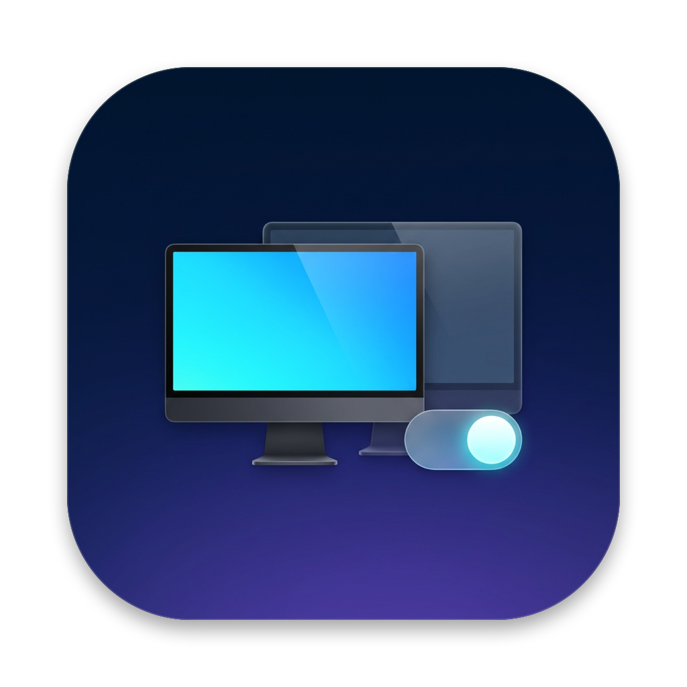

<p align="center">
  
</p>

# MonitorBlock

轻量级 macOS 菜单栏工具，用于在 Apple Silicon Mac 上**随时安全地启用/停用任意显示器（含 MacBook 内置屏与外接屏）、自定义显示器名称、调整多屏布局，并配置关闭屏幕后的自动布局规则**。

## 特性

- **现代控制中心式菜单栏面板（Popover UI）**：卡片化展示所有显示器开关、音量滑块、音频输出设备和布局预设，点击即控。
- **系统级软断开（支持内置屏 + 外接屏）**：动态调用 `CGSConfigureDisplayEnabled`，停用后屏幕从桌面拓扑中移除（窗口自动收回），需要时一键点亮。
- **外接屏信号输入源切换（HDMI 1/2、DP 1/2、USB-C）**：原生兼容 LG 专有 `I2C 0x50 + VCP 0xF4` 与标准 MCCS `VCP 0x60`，菜单栏一键切换外接屏视频输入源。
- **外接屏音量调节 & 音频输出切换**：支持一键切换任意系统音频输出设备；系统音量走 CoreAudio，HDMI/DP 外接显示器自动桥接 Apple Silicon DDC/CI（VCP `0x62` 音量 / `0x8D` 静音），同时支持展开独立调节多台外接屏硬件音量。
- **屏幕识别与自定义名称**：一键在每块屏幕正中央闪显名称与分辨率，支持按 UUID 自定义名称，轻松区分同型号双屏。
- **实时多屏布局编辑与预设**：可视化拖拽调整显示器相对位置（支持自动贴边吸附与一键设为主屏），可保存多个命名布局预设一键切换。
- **关闭屏幕后自动切换布局**：为任意显示器（含内置屏）独立配置“关闭它之后，剩余屏幕的排列方式与主屏”，关闭时自动生效；重新开启该屏时支持自动恢复关闭前的原布局。
- **开机自启动与安全兜底**：内置开机自启动开关；严格使用 `kCGConfigureForSession`；禁止停用最后一块活跃屏幕；外接屏全部拔出时自动恢复内置屏。

## 构建与运行

```bash
# 运行单元测试
swift test

# 打包为标准 macOS 菜单栏应用
chmod +x scripts/bundle_app.sh
./scripts/bundle_app.sh

# 启动应用
open build/MonitorBlock.app
```

也可以将 `build/MonitorBlock.app` 拖入 `/Applications`，并在“系统设置 -> 通用 -> 登录项”中设为开机自启。

## 应急恢复说明

由于本工具严格使用 `kCGConfigureForSession`：
- 如果遇到任何显示状态异常，**重新拔插显示器线缆**或**注销/重启 macOS**即可恢复默认显示状态，无需修改任何系统文件。
